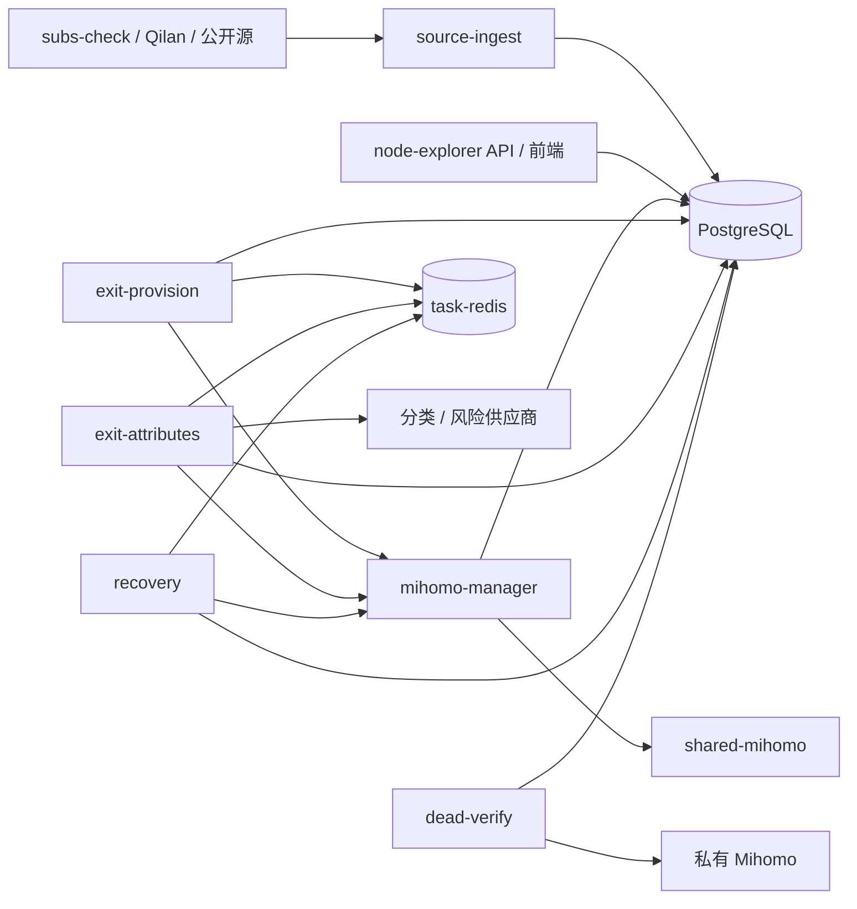

# 服务现状与重构 TODO

记录日期：2026-10-26。代码基线：`5ddcd26`。本目录包含实施前规划和本轮独立测活的实施记录，现状以本节更新及 10-node-liveness.md 为准。

## 本轮实施更新

独立测活已实现，详见 [10-node-liveness.md](10-node-liveness.md)。该文档是测活重构入口，覆盖新服务边界、Xray 筛选、Mihomo 补测、数据所有权、部署和验收。

- [x] 新增完全独立的 node-liveness，唯一维护节点可用状态。
- [x] 删除 recovery、dead-verify、manager 巡检与来源 TCP 准入。
- [x] 出口和属性服务不再写测活事实或投递测活任务。
- [x] 更新部署、监控和本地测试。
- [ ] 部署后测量生产成功率、回退比例、吞吐与资源占用。
- [ ] 按各服务文档继续重构 API、来源、manager、出口和属性服务。

当前六个应用服务为 node-explorer、source-ingest、node-liveness、mihomo-manager、exit-provision、exit-attributes。以下为实施前的盘点与规划，涉及 recovery / dead-verify / manager 测活的建议已经被本轮独立性要求替代，不再执行。

## 分析范围与依据

以当前仓库的 [Compose](../../compose.yaml)、[服务边界说明](../../MODULAR_SERVICES.md)、[worker 入口](../../backend/cmd/node-worker/main.go)、[任务执行器](../../backend/internal/service/runner.go)、[API 路由](../../webman/config/route.php) 为主要依据。此前内核评估观察过生产容器；本轮没有重新连接生产服务器，因此以下清单描述仓库部署设计，不代表即时运行健康报告。实际启用的上游、配置值和容量需在实施前复核。

历史 [REFACTOR_PLAN](../REFACTOR_PLAN.md) 含有已落地和已被替代的方案。本目录按当前代码重新规划，不把已有服务拆分、故障准入、巡检重试等机制重复当作缺失功能。

## 当前有哪些服务

| 类型 | 服务 | 当前职责 | 主要依赖 | 任务消费范围 | 重构文档 |
| --- | --- | --- | --- | --- | --- |
| 应用 | node-explorer | PHP/webman API、鉴权、节点查询、服务监控、前端静态资源 | PostgreSQL | 无 Redis 任务 | [API 与前端](01-node-explorer.md) |
| 应用 | source-ingest | 多源导入、准入、注册表同步、监控采样、历史保留清理 | PostgreSQL、上游网络/挂载文件 | 无 Redis 任务 | [采集](02-source-ingest.md) |
| 应用 | mihomo-manager | 共享内核控制、配置重载、探测租约、全量/补偿巡检 | PostgreSQL、shared-mihomo | 巡检在进程内执行 | [内核管理](03-mihomo-manager.md) |
| 应用 | exit-provision | 实际出口 IP 核验、刷新、产生属性/风险后续任务 | PostgreSQL、Redis、manager exit 通道 | exit | [出口核验](04-exit-provision.md) |
| 应用 | exit-attributes | 多供应商 IP 分类、IPPure 风险查询与刷新 | PostgreSQL、Redis、外部 API、manager risk 通道 | attributes、risk | [属性与风险](05-exit-attributes.md) |
| 应用 | recovery | 住宅/普通节点恢复评估、依赖检测与生命周期动作 | PostgreSQL、Redis、manager | recovery、normal-recovery、fast-delay、connectivity、lifecycle | [恢复](06-recovery.md) |
| 应用 | dead-verify | 长期失活复核、受保护永久删除、批量快照压缩 | PostgreSQL、进程内启动的私有 Mihomo | 独立批处理，不走 Redis | [失活复核](07-dead-verify.md) |
| 基础设施 | shared-mihomo | 共享代理执行内核 | manager 下发配置 | 无业务任务 | [基础设施](08-infrastructure-operations.md) |
| 基础设施 | task-redis | 任务引用投递、跨进程限流状态 | 持久卷 | 不保存业务事实主账本 | [基础设施](08-infrastructure-operations.md) |
| 外部基础设施 | PostgreSQL | 节点、任务、租约、证据、生命周期和监控事实 | 外部数据库部署 | 持久任务账本 | [基础设施](08-infrastructure-operations.md) |
| 可选上游 | subs-check | 生成供 source-ingest 导入的订阅结果 | 独立 Compose、输出目录 | 上游自己的流程 | [基础设施](08-infrastructure-operations.md) |

共 **7 个应用服务**；默认 Compose 还定义 **2 个支撑容器**。PostgreSQL 为外部依赖；subs-check 为可选附加容器。[Qilan Compose](../../compose.qilan.yaml) 只扩展 source-ingest 的环境与会话文件挂载，不增加服务。公开源 provider 也在采集进程内运行。

前端随 node-explorer 交付，不是独立生产服务。systemd 的 node-list 启停单元、更新 service/timer、备份脚本属于运维自动化。审计/基准/一次性清理命令不列为常驻业务服务。已退役的 Node API、旧 patrol、独立 lifecycle、node-cleanup 不应恢复为待重构服务。

## 当前依赖关系

箭头表示访问依赖，不是全部数据流。各应用共享数据库，目前并非每服务独立数据库的微服务架构；重构优先划清代码与写入职责，不预设继续增加容器。

## 总 TODO 与建议顺序

P0：先确定不可破坏的契约；P1：主要职责拆分与可靠性；P2：依赖测量后推进的优化或可选能力。优先级不表示已发现线上故障。

- [ ] **阶段 0 / P0**：完成 [公共契约与任务底座](09-common-contracts.md) 的 COMMON-01～04，登记数据写入所有权、启动迁移、任务与健康状态语义。
- [ ] **阶段 1 / P1**：按 [基础设施](08-infrastructure-operations.md) 建立资源、恢复和部署基线，再逐服务改动；先完成验收方案，故障演练使用隔离环境。
- [ ] **阶段 2 / P1**：重构 [node-explorer](01-node-explorer.md) 与 [source-ingest](02-source-ingest.md)，分离查询、采集和维护职责。双方分别验收，可独立推进。
- [ ] **阶段 3 / P1**：重构 [mihomo-manager](03-mihomo-manager.md)，先保持 Mihomo 现有行为，稳定探测与配置接口。
- [ ] **阶段 4 / P1**：基于稳定接口重构 [exit-provision](04-exit-provision.md) 和 [exit-attributes](05-exit-attributes.md)。
- [ ] **阶段 5 / P1**：重构 [recovery](06-recovery.md)，显式表达依赖检测和生命周期状态机。
- [ ] **阶段 6 / P1**：重构 [dead-verify](07-dead-verify.md)，重点审查并发删除保护与证据一致性，再做吞吐优化。
- [ ] **阶段 7 / P2**：在 manager 接口与基准明确后，决定是否开展 Xray 优先、Mihomo 兜底试点；不与结构重构一次上线。

## 每个服务的完成条件

每次实施均需附：改动边界、涉及表/接口、配置兼容性、针对性验证、上线观测指标和回退步骤。先记录节点规模、每类任务最老等待时间、探测耗时、错误类别、资源占用等基线，再约定可量化目标；当前分析没有足够数据承诺吞吐提升比例。

保持现有身份与分享链接契约、任务 generation/lease、内核配置代际与租约隔离、证据新鲜度、删除保护。不得通过放宽 TLS、把基础设施故障计作节点死亡、清空任务账本等方式获得表面成功率。

文档勾选应以实际验收证据为准；本轮只完成现状分析和计划编制。
